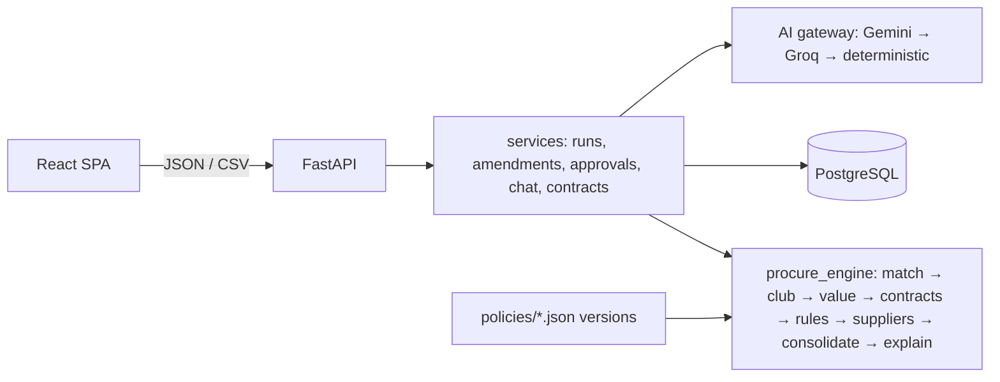

# APPROACH.md

## Architecture in one paragraph
A **pure, deterministic decision engine** (`backend/procure_engine`, no I/O) turns PR rows, a master-data snapshot
and versioned policy documents into decisions with a full trace. A FastAPI app persists runs, serves the API and
the React SPA, and handles approvals, amendments, contracts and chat. The policy is **data**: a typed DSL (params,
ordered rules, conditions over a fact registry, item sets, routes) stored as versions with effective dates.

## Why a deterministic core with AI at the edges
Forty percent of the score is automated decision accuracy, and the blind test repeats Run 1 and Run 2 on the same
batch. An LLM in the decision loop would be non-reproducible. So LLMs only **translate**:
chat → slots, amendment text → policy ops, PDF → contract fields. Every translation is validated, shown in plain
language with its source quote, and confirmed by a person; routes, prices and suppliers are never an LLM output,
and item codes always come from the item master. Everything also works with **no key**: a deterministic chat
parser, a pattern-based amendment reader that refuses to guess new rules, a deterministic contract PDF parser, and
a structured rule editor that produces the same ops as the AI.

## How the policy change works
`ops` (set_param, add_rule, modify_rule, add_item_set, set_supplier_override, set_ranking, …) are applied to a copy
of the active version → validated (unknown facts, operators, params, item sets are errors at load time) → linted →
described in plain language → simulated on the latest batch (impact preview) → approved → active from its
effective date. Each requirement is decided by the version in force on its requirement date; a run can be pinned to
a version to reproduce Run 1. Twelve drills (A1–A12) are expressed as ops and tested for exact decision deltas.

## AI tools used
* **Coding:** Claude Code (Anthropic) wrote most of the code under the repo's `AGENTS.md` rules, working phase by
  phase from `PLAN.md`; every module is small and explainable in one sentence.
* **In the app:** Gemini (JSON output, temperature 0) with Groq as a fallback, used only for amendment reading and
  chat slot extraction, and only when an API key is configured.

## Trade-offs
* Rule conditions are a small expression language rather than free code: less flexible, but safe, diffable and
  explainable. A new *fact* is a one-function change.
* The deterministic amendment reader handles parameter-style changes (limits, windows, dates, supplier blocks,
  weights, suggestion counts) and asks for the structured editor otherwise. On our twelve prose drills it reads 7
  exactly and refuses the other 5 (they need new rules); with a key the LLM path covers those.
* Batch runs are isolated (ceilings start from the register); live approvals commit to a ledger.
* Authentication is out of scope: a role switcher sets `X-User` and every action is audited under that name.

## What we would do next
Real SSO and role enforcement; supplier status history; UoM conversion table; PDF fallback by LLM for unfamiliar
contract layouts; concurrency control on approvals; a nightly LLM eval run in CI.
