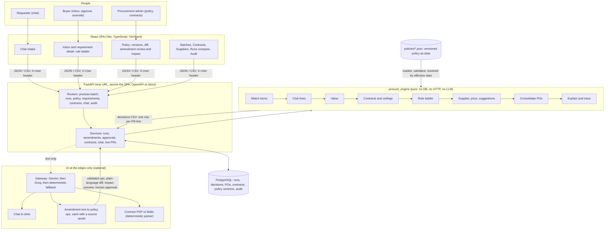
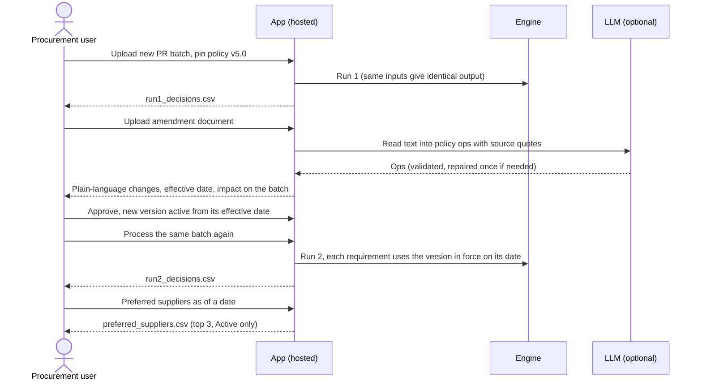
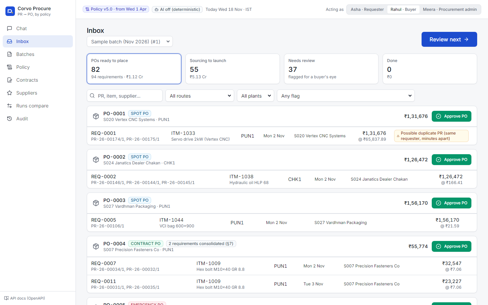
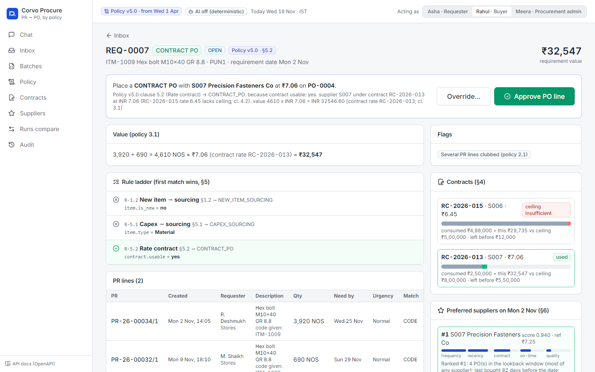

# Corvo PR-to-PO

A policy-driven procurement app for Corvo Engineering: employees raise purchase requests by chatting; the app
decides, by the active procurement policy, whether to place a PO or raise a sourcing request; and Procurement can
change the policy (by document, chat or editor) without any code change.

**Hosted app:** https://corvo-procure.onrender.com · **API docs:** [/docs](https://corvo-procure.onrender.com/docs) · 

## Task data is not in this repo
The Cantill task kit (brief, policy, worked examples, master data, contracts, sample batch) is deliberately **not
committed**. The hosted app is already seeded. To seed a fresh database or run the data-dependent tests, place the
kit in `data/kit/` (or set `KIT_DIR`); without it the app starts with no master data and those tests skip.

## Run it
```bash
docker compose up            # Postgres + app → http://localhost:8000
```
No keys are needed. Optional: `GEMINI_API_KEY` / `GROQ_API_KEY` (see `.env.example`) let an LLM read amendment
documents and chat; without them deterministic readers and the structured editor are used.

Local development without Docker (SQLite):
```bash
python -m venv .venv && .venv/bin/pip install -e "backend[dev]"        # Windows: .venv\Scripts\pip
cd frontend && npm ci && npm run build && cd ..                         # the SPA is served by FastAPI
cd backend && ../.venv/bin/uvicorn app.main:app --port 8000            # migrates and seeds on start
```

## Demo users and a 3-minute tour
Use the role switcher in the header: **Asha** (requester), **Rahul** (buyer), **Meera** (procurement admin).
1. *Asha* → **Chat**: "need 200 nitrile gloves for Chakan by next Friday". Answer the urgency question, confirm.
2. *Rahul* → **Inbox**: the sample batch is already processed. Open any requirement: value maths, the rule ladder
   (✓/✗ with the actual numbers), contract ceiling bars, supplier ranking, sentence explanation. Approve a
   consolidated PO; try **Override** (comment required, blocked suppliers not selectable); see it in **Audit**.
3. *Meera* → **Policy** → *Propose amendment* → structured editor: change `Spot PO limit` to 300000 effective
   10 Nov → review the plain-language diff and impact → **Approve** → **Batches**: process the sample again (Run 2)
   → **Runs compare**. Pin v5.0 to reproduce Run 1 byte for byte.
4. **Suppliers**: ranked preferred lists with score components; export the top 3 as CSV for any date.

## API quickstart
```bash
H=http://localhost:8000
# Run 1, pinned to v5.0
curl -s -F file=@data/kit/pr_batches/sample_pr_batch.csv "$H/api/process-batch?format=csv&policy_version=5.0" -o run1.csv
# propose an amendment as structured ops, then approve it (v5.1)
curl -s -H 'X-User: Meera' -H 'Content-Type: application/json' "$H/api/policy/amendments" \
  -d '{"ops":[{"op":"set_param","name":"spot_limit","value":300000}],"effective_from":"2026-11-10"}'
curl -s -X POST -H 'X-User: Meera' "$H/api/policy/amendments/1/approve"
# Run 2 (effective-dated), then the preferred suppliers as of a date
curl -s -F file=@data/kit/pr_batches/sample_pr_batch.csv "$H/api/process-batch?format=csv" -o run2.csv
curl -s "$H/api/preferred-suppliers/export.csv?as_of=2026-11-19&top=3" -o preferred.csv
```
Amendment text or a document works the same way: `-d '{"text":"…"}'` or `-F file=@amendment.pdf`.

## Architecture (end to end)


AI never decides a route, price or supplier, and never invents an item code. Every AI output is validated, shown with
its source quote, and approved by a person. Everything works with no API key.

## Blind-test flow


## How it is built
`backend/procure_engine` is the pure engine; `backend/app` is the API, services, AI gateway and persistence;
`frontend` is the React UI; `policies/` holds the versioned policy; `fixtures/` the amendment drills and chat
scripts. See [APPROACH.md](APPROACH.md), [DECISIONS.md](DECISIONS.md) and [docs/policy-dsl.md](docs/policy-dsl.md).

## Tests
```bash
cd backend && pytest -q                       # with the kit in data/kit: golden, snapshot, boundaries,
                                              # Hypothesis invariants, A1–A12 drills, API, 21 chat scripts
.venv/bin/python scripts/check_no_policy_constants.py   # no policy constants or IDs in the engine
bash scripts/e2e.sh                           # Playwright smoke (needs the built SPA)
```

## Screenshots
| Inbox | Requirement | Policy |
|---|---|---|
|  |  |  |
